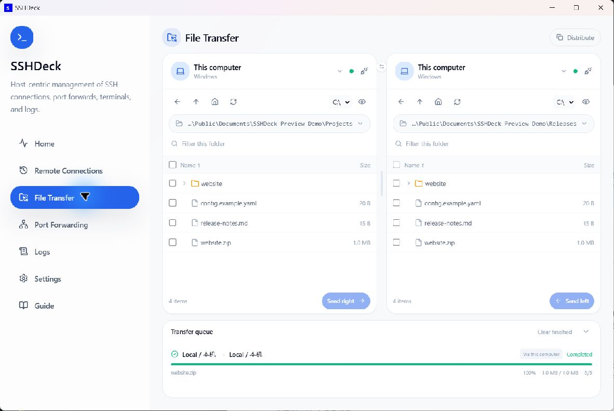
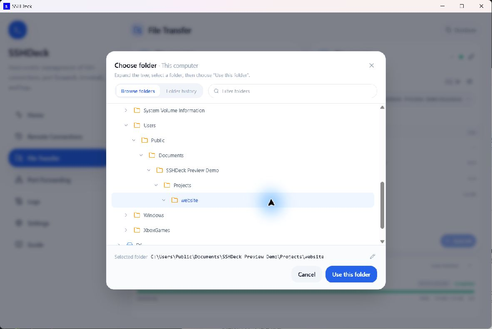
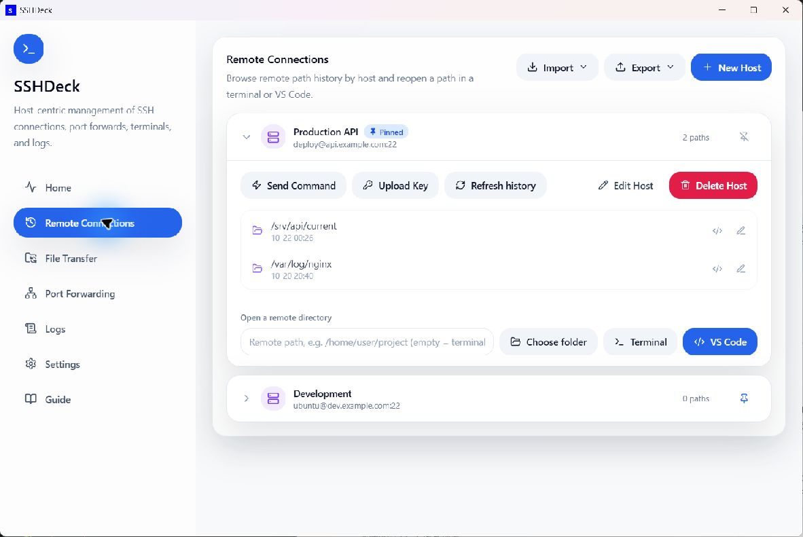
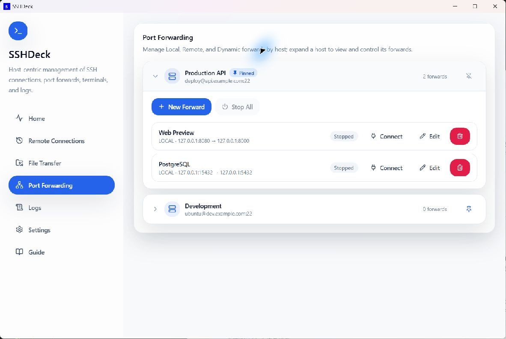

# SSHDeck

**English** | [中文](README.zh.md)

SSHDeck is a Windows app for managing SSH connections, port forwarding, and file transfers in one place.

## Screenshots

Click an image to view it at full size. Screenshots show the 0.4 interface.

### File Transfer

[](docs/Pictures/preview-en-files.jpg)

<details>
<summary>Folder picker and history</summary>

[](docs/Pictures/preview-en-folders.jpg)

</details>

### Remote Connections

[](docs/Pictures/preview-en-remote.jpg)

### Port Forwarding

[](docs/Pictures/preview-en-forwarding.jpg)

## Features

- **Manage your servers** — save and pin hosts, use jump hosts, and import or export SSH configurations.
- **Forward ports** — local, reverse, and SOCKS forwarding, with automatic reconnect and one-click browser access.
- **Transfer files** — browse two folders side by side, choose from directory trees or history, and copy files or folders with multiple selection and drag and drop.
- **Distribute to multiple hosts** — choose recipients and destination folders; optionally send directly between servers without routing file contents through your computer.
- **Open your workspace** — choose a remote folder from the tree or history, open it in a terminal or VS Code, run commands, and set up key-based login.
- **Track activity** — view connections, transfer progress and logs, and cancel or retry transfers as needed.
- **Make it yours** — light/dark themes, Chinese/English, and in-app updates with Stable and Preview channels.

## Download & Run

Download the [v0.4.0 stable release](https://github.com/Trilives/sshdeck/releases/tag/v0.4.0) from GitHub Releases:

- Recommended installer: `SSHDeck_0.4.0_x64-setup.exe`
- Install-free ZIP: `SSHDeck_0.4.0_x64-portable.zip` — extract it, then run `SSHDeck.exe` directly.

When launched directly, the installer first offers a Simplified Chinese / English language selector, then shows the standard setup wizard where you can keep or change the installation folder. In-app upgrades keep the existing installation folder and replace the installed version in place.

The portable package stores settings and hosts in `%LOCALAPPDATA%\SSHDeck\data`, not beside the executable. It requires Windows OpenSSH Client and Microsoft Edge WebView2 Runtime. To remain install-free, update it by downloading a newer portable ZIP; the in-app updater follows the installer update path.

> Upgrading from v0.3.0-beta.4 or earlier: export your hosts before updating, then import them after launching the new version. The old data directory is not migrated automatically.

Using the installed edition? Open **Settings → Software Update** and click **Check for updates**.

Before running, make sure the Windows OpenSSH Client is installed and that PowerShell can run:

```powershell
ssh -V
```

## Quick Start

1. Open the app, go to Remote Connections, click "New Host", and fill in the SSH host, user, port, and private key file.
2. Go to Port Forwarding, expand the host, click "New Forward", and fill in the bind and target parameters.
3. Click "Connect" on the forward. The app detects the auth method automatically: it connects directly when passwordless, or pops up a password prompt when needed.
4. Use the Home page to watch current connections and key events, and the Logs page for the full runtime log.

In **Remote Connections**, expand a host and click **Choose folder** to browse its directories or history. Open the selected folder directly with **Terminal** or **VS Code** in the dialog.

## File Transfer

1. Open **File Transfer** and choose a computer or saved server on each side.
2. Click a path bar to open the folder picker. Expand the tree or choose a history entry, then click **Use this folder**.
3. Select files or folders and click Send, or drag them into the other pane. Confirm the destination and how to handle existing files.
4. Enable **Distribute** for multiple recipients. For two remote endpoints, **Bypass this computer** is available in the transfer confirmation dialog.

When authentication is needed, connect with a password or upload this computer's public key for future passwordless access. The key button at the top of each remote pane also opens these options. Both key upload and direct setup check existing passwordless access first and skip key changes when it already works.

With **Bypass this computer** enabled, choose **Set up direct SSH access** to authorize the source server's public key on the destination and verify the connection. Configure each recipient separately when distributing files. A dedicated key is generated on the source if needed; its private key stays there. Passwords are requested when needed and never saved to configuration. Automatic setup supports POSIX/OpenSSH servers with standard `/etc/ssh/ssh_host_*_key.pub` files; other environments can be configured manually.

Direct transfers require `sftp` on the source and a destination address and port reachable from it. Symbolic links and special files are not copied yet; remote overwrite requires the OpenSSH `posix-rename` extension. The portable edition updates by downloading a newer ZIP.

## Common Example

Suppose a service on the remote server listens only on `127.0.0.1:8000` and you want to open it in your local browser:

| Field | Value |
| --- | --- |
| Mode | `local` (chosen in the port forward) |
| SSH host | server IP or domain (set on the host) |
| SSH port | `22` |
| SSH user | `root` / `ubuntu` / `deploy` |
| Bind host | `127.0.0.1` |
| Local access port | `8000` |
| Target host | `127.0.0.1` |
| Remote port to map | `8000` |

After connecting, open in your local browser:

```text
http://127.0.0.1:8000
```

The equivalent command is roughly:

```powershell
ssh -N -T -L 127.0.0.1:8000:127.0.0.1:8000 user@server -p 22
```

## Choosing a Forwarding Mode

| Mode | When to use |
| --- | --- |
| Local | Forward a local port to a service the remote server can reach. Most common — good for remote databases and web services. |
| Remote | Reverse-forward a remote port to a local service. Good for temporarily exposing a local dev service. |
| Dynamic | Create a SOCKS proxy. Usually only the bind host and local access port are needed. |

## Filling in the Key File

The host's "Key File" field:

- Empty: uses the default `%USERPROFILE%\.ssh\id_ed25519`.
- Absolute path: e.g. `C:\Users\you\.ssh\id_rsa`.
- `~` form: e.g. `~/.ssh/id_ed25519`.
- Point to the **private key itself**, not the `.pub` public key file.
- If no private key exists at that path, "Upload Key" generates an ed25519 key pair first and then uploads the public key.

## Passwords & Keys

Prefer SSH keys or `ssh-agent`.

If passwordless login is not set up yet, click "Upload Key" on the host, enter the password once, and the app writes your local public key into the remote host's `authorized_keys` so you can connect without a password afterward.

If the host only allows password login, just click "Connect" on the forward — when a password is required, a prompt appears automatically:

- The password is not saved to the config file.
- If "keep connected" is enabled, the password is kept only in memory during this app session, for reconnecting after unexpected drops.
- On first connection to a new host, the app records the fingerprint using OpenSSH's `accept-new` policy; if the fingerprint later changes, the connection is refused and a dialog lets you verify before trusting the new key.

> "Send command" and "Open terminal" rely on passwordless login being configured.

## Where Data Is Stored

Host and forward config, settings, and logs are stored in the Windows app-data directory, never in the source tree or the program folder.
The old `profiles.json` from v0.1.x is no longer used; it is backed up to `profiles.json.v0.1.bak` on startup.

## Contributors

- Trilives
- Codex
- Claude

## License

This project is licensed under the MIT License — free to use, modify, and distribute. See [LICENSE](LICENSE).

> A small project made on a whim, originally just for my own use, open-sourced along the way. Help yourself.

## Technical Docs

- Architecture, data model, module layout, tech stack, dev environment, build, and release notes: see [docs/ARCHITECTURE.md](docs/ARCHITECTURE.md).
