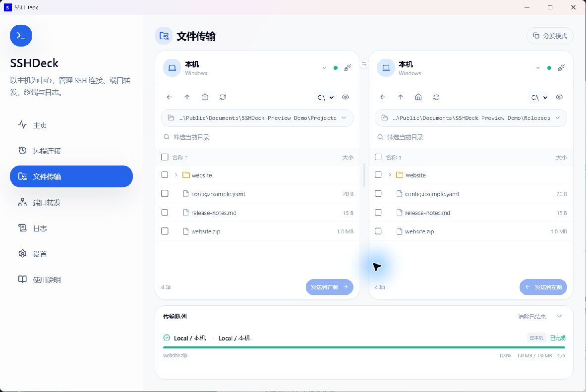
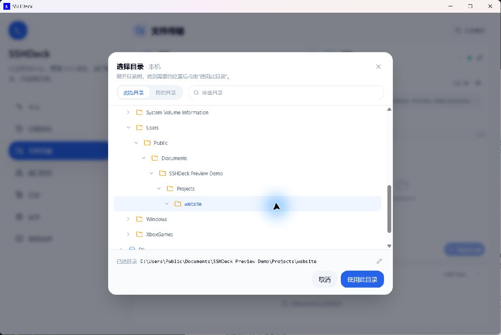
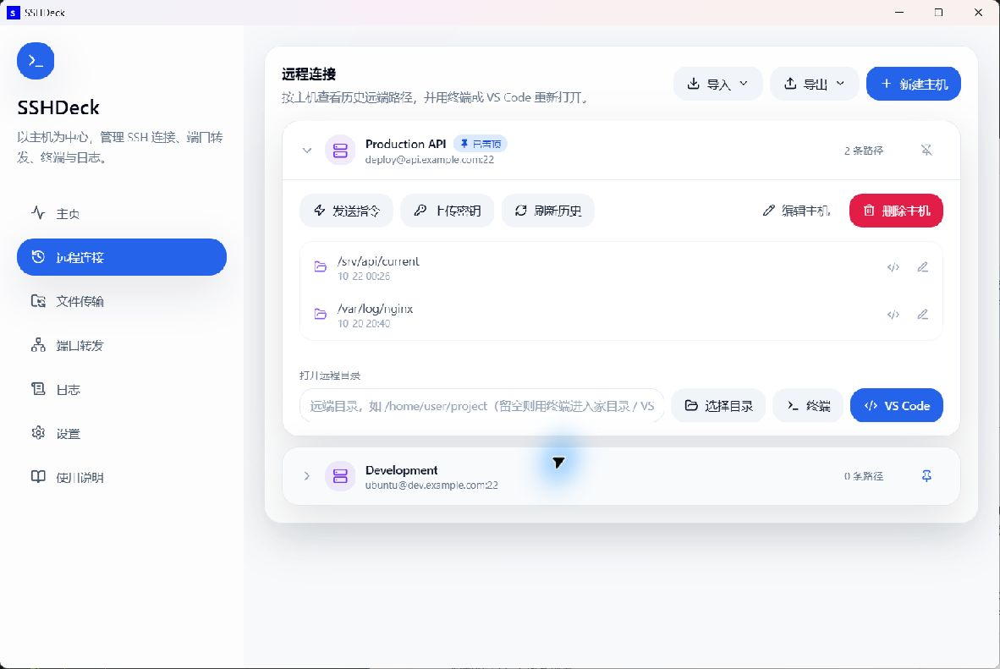
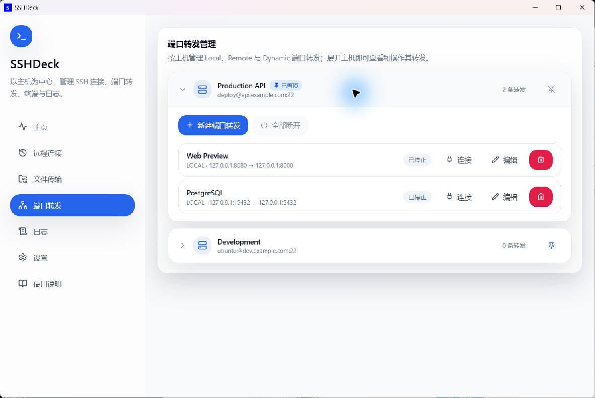

# SSHDeck

[English](README.md) | **中文**

SSHDeck 是一个面向 Windows 的 SSH 管理工具，在一个界面里管理远程连接、端口转发和文件传输。

## 界面预览

点击图片可查看原图。截图展示 0.4 预览版。

### 文件传输

[](docs/Pictures/preview-zh-files.jpg)

<details>
<summary>目录选择与历史记录</summary>

[](docs/Pictures/preview-zh-folders.jpg)

</details>

### 远程连接

[](docs/Pictures/preview-zh-remote.jpg)

### 端口转发

[](docs/Pictures/preview-zh-forwarding.jpg)

## 主要功能

- **管理服务器**：保存、置顶主机，支持跳板机和 SSH 配置导入导出。
- **端口转发**：支持本地、反向转发与 SOCKS 代理，可自动重连、一键打开网页。
- **文件传输**：双栏浏览目录，从目录树或历史记录选择位置，支持多选、拖拽和整目录复制。
- **批量分发**：一次发送到多台主机，分别指定目标目录；也可让远程主机直接传输，不经过本机。
- **打开工作环境**：从目录树或历史记录选择远程路径，用终端或 VS Code 打开，发送指令、配置免密登录。
- **查看运行状态**：集中查看连接、传输进度和日志，支持取消、重试传输。
- **外观与更新**：浅色 / 深色主题、中文 / 英文界面，内置稳定版与预览版更新通道。

## 下载与运行

文件传输和新目录选择器目前在 [0.4 预览版](https://github.com/Trilives/sshdeck/releases/tag/v0.4.0-beta.3)中提供。安装版用户也可选择「预览」更新通道体验。

从 GitHub Releases 下载 `v0.3.1`：

- 推荐下载安装包：`SSHDeck_0.3.1_x64-setup.exe`
- 免安装压缩包：`SSHDeck_0.3.1_x64-portable.zip`，解压后直接运行 `SSHDeck.exe`。

直接运行安装包时，会先显示简体中文 / English 语言下拉选择框，随后进入标准安装向导，可保留或修改安装位置。应用内升级会沿用现有安装目录并原地覆盖，不改变当前升级体验。

免安装版的设置与主机数据保存在 `%LOCALAPPDATA%\SSHDeck\data`，不会写在程序旁边；系统需要 Windows OpenSSH Client 和 Microsoft Edge WebView2 Runtime。如需保持免安装方式，请手动下载新版 ZIP，应用内更新沿用安装版更新流程。

> 从 beta.4 或更早版本升级：请先导出主机，升级后再在 v0.3.1 中导入。旧数据目录不会自动迁移。

使用安装版时，可直接打开「设置 → 软件更新」，点击「检查更新」。

运行前请确认 Windows 已安装 OpenSSH Client，并且 PowerShell 中可以执行：

```powershell
ssh -V
```

## 快速上手

1. 打开程序后进入「远程连接」页，点击「新建主机」，填写 SSH 主机、用户、端口和私钥文件。
2. 进入「端口转发」页，展开该主机，点击「新建端口转发」，填写监听与目标参数。
3. 在转发上点击「连接」，程序会自动判断认证方式：能免密则直接连接，需要密码时会自动弹出密码输入框。
4. 在「主页」查看当前连接和关键事件，在「日志」页查看完整运行日志。

在「远程连接」中展开主机，点击「选择目录」，可浏览该主机的目录树或历史目录。确认后，再点击「终端」或「VS Code」打开。

## 文件传输

1. 打开「文件传输」，在两侧选择本机或已保存的服务器。
2. 点击路径栏打开目录选择器，从目录树逐级展开，或选用历史目录，最后点击「使用此目录」。
3. 多选文件或文件夹后点击发送，也可拖到另一侧；确认目标目录和同名文件处理方式后加入队列。
4. 需要发送到多台主机时开启「分发模式」。两端均为远程主机时，可在传输确认页开启「不经过本机」。

直连需要来源主机安装 `sftp`、能免密登录接收主机，并已信任接收端指纹；不满足时保持该选项关闭即可。符号链接和特殊文件暂不复制；远端覆盖需要服务端支持 OpenSSH `posix-rename` 扩展。免安装版请下载新版 ZIP 更新。

## 常用样例

如果远程服务器上有一个服务只监听 `127.0.0.1:8000`，你希望在本地浏览器打开它：

| 字段 | 填写 |
| --- | --- |
| 主机模式 | `local`（在端口转发里选） |
| SSH 主机 | 服务器 IP 或域名（建主机时填） |
| SSH 端口 | `22` |
| SSH 用户 | `root` / `ubuntu` / `deploy` |
| 监听地址 | `127.0.0.1` |
| 本机访问端口 | `8000` |
| 目标地址 | `127.0.0.1` |
| 远程待映射端口 | `8000` |

连接成功后，在本地浏览器访问：

```text
http://127.0.0.1:8000
```

等价命令大致是：

```powershell
ssh -N -T -L 127.0.0.1:8000:127.0.0.1:8000 用户名@服务器地址 -p 22
```

## 转发模式怎么选

| 模式 | 适用场景 |
| --- | --- |
| Local | 把本地端口转发到远程服务器能访问到的服务。最常用，适合远程数据库、远程 Web 服务。 |
| Remote | 把远程端口反向转发到本机服务。适合临时暴露本地开发服务。 |
| Dynamic | 创建 SOCKS 代理。通常只需要监听地址和本机访问端口。 |

## 密钥文件怎么填

主机的「私钥文件」字段：

- 留空：使用默认 `%USERPROFILE%\.ssh\id_ed25519`。
- 绝对路径：例如 `C:\Users\you\.ssh\id_rsa`。
- `~` 写法：例如 `~/.ssh/id_ed25519`。
- 请指向**私钥本身**，不要填 `.pub` 公钥文件。
- 如果该路径下没有私钥，「上传密钥」会自动生成一对 ed25519 密钥再上传公钥。

## 密码与密钥

推荐优先使用 SSH 密钥或 `ssh-agent`。

如果还没有配置免密登录，可以在主机上点击「上传密钥」，输入一次密码后，程序会把本地公钥写入远程主机的 `authorized_keys`，之后即可免密连接。

如果该主机只能用密码登录，直接点击转发的「连接」即可——程序检测到需要密码时会自动弹出密码输入框：

- 密码不会保存到配置文件。
- 如果开启「保持连接」，密码只会在本次应用运行期间保留在内存中，用于异常断开后的自动重连。
- 首次连接新主机时，程序使用 OpenSSH 的 `accept-new` 策略自动记录指纹；若之后指纹发生变化，连接会被拒绝并弹窗，由你核对后决定是否信任新密钥。

> 「发送指令」和「打开终端」依赖已配置好的免密登录。

## 数据保存位置

主机与转发配置、设置和日志保存在 Windows 应用数据目录中，不会保存在源码目录或程序所在目录。
v0.1.x 的旧 `profiles.json` 不再使用，启动时会自动备份为 `profiles.json.v0.1.bak`。

## 贡献者

- Trilives
- Codex
- Claude

## 开源协议

本项目采用 MIT 协议，可自由使用、修改和分发，详见 [LICENSE](LICENSE)。

> 这是一时兴起做的小项目，最初只是为了方便自己用，顺手开源出来，欢迎自取。

## 技术文档

- 架构、数据模型、模块划分、技术栈、开发环境、构建与发布说明见 [docs/ARCHITECTURE.md](docs/ARCHITECTURE.md)。
